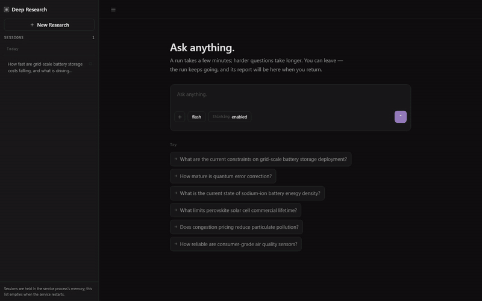
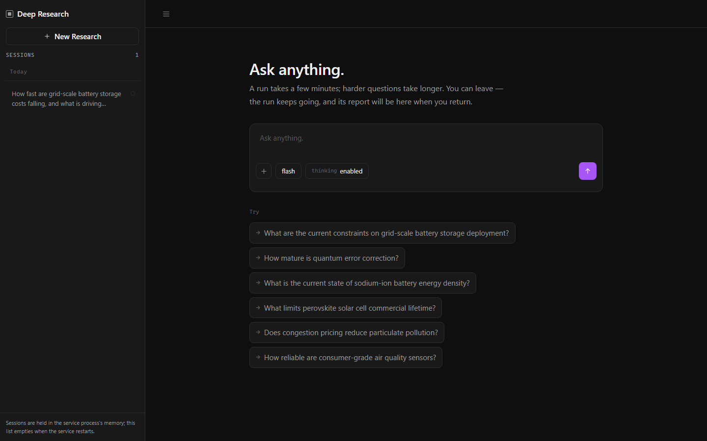
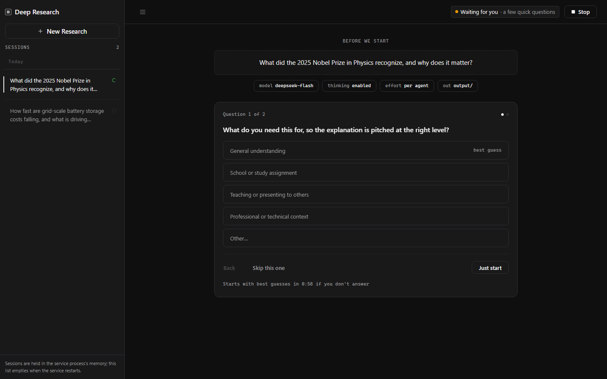
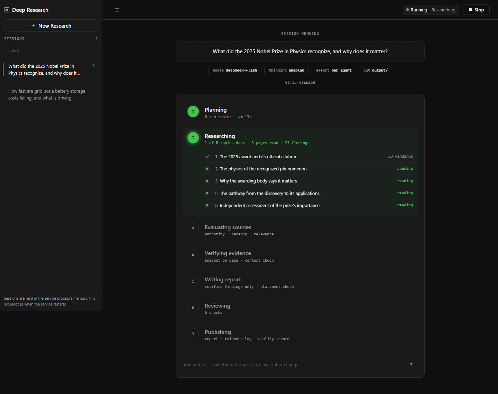
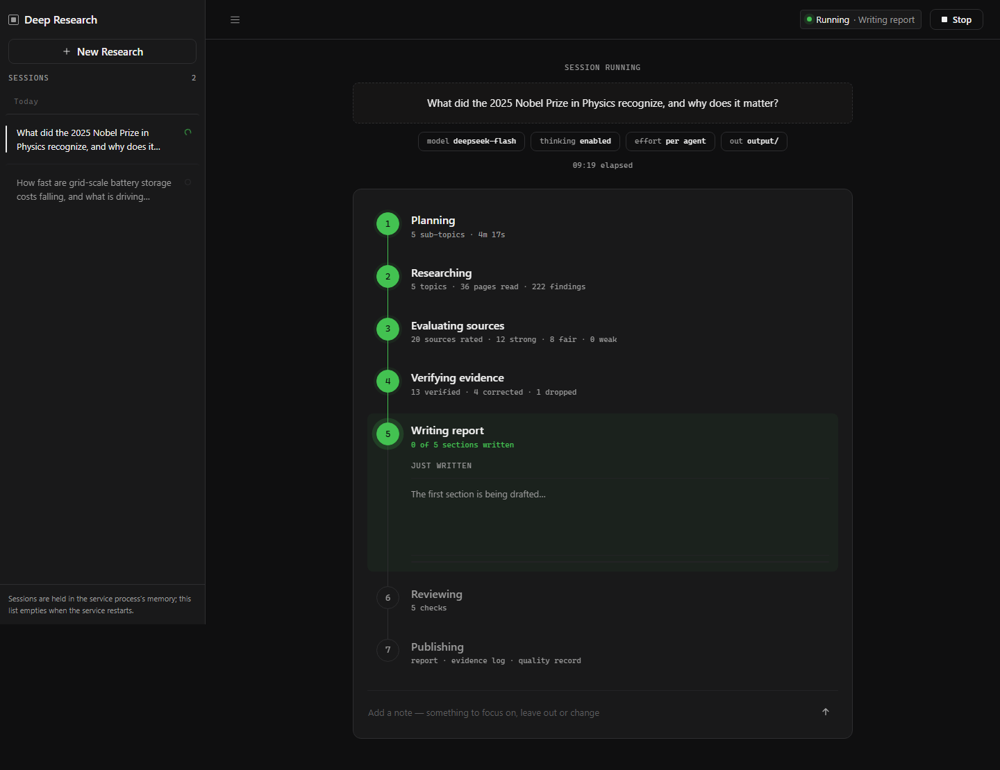
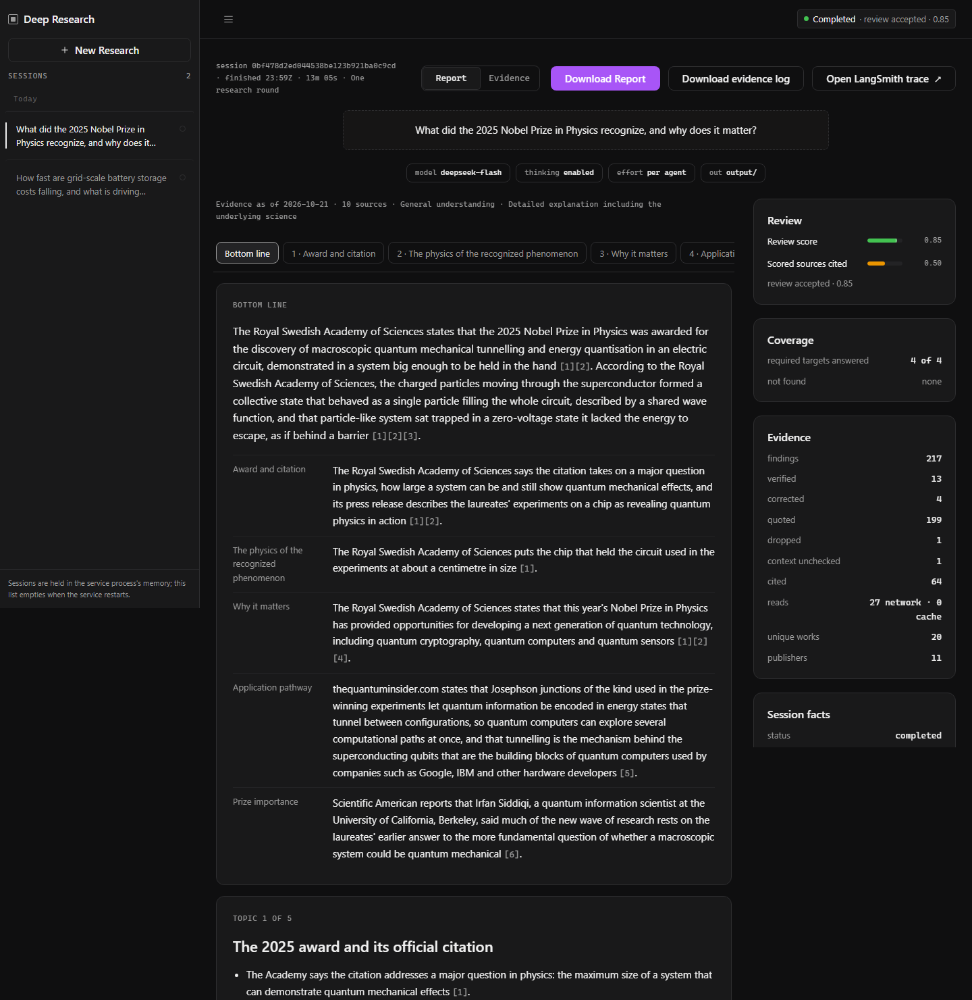
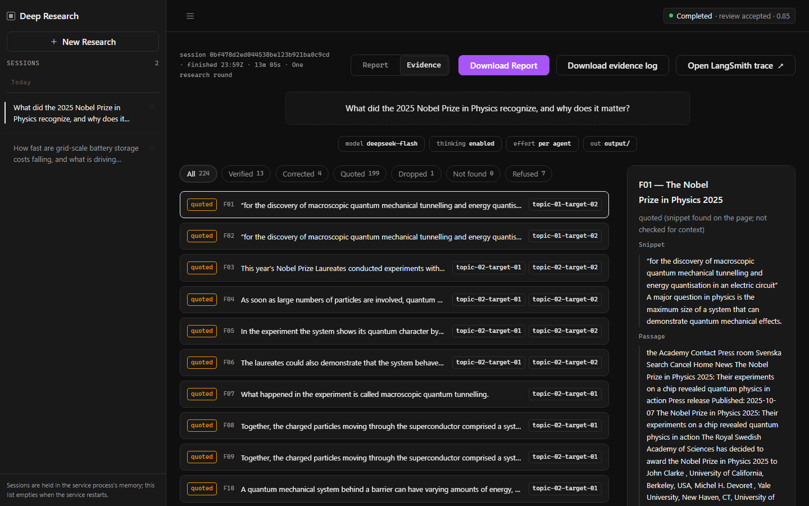

# Deep Research

Deep Research turns a research question into a cited Markdown report. A
[LangGraph](https://langchain-ai.github.io/langgraph/) pipeline plans the
question, searches and reads the web, checks every finding against the page it
came from, drafts a report that cites only checked findings, and has a reviewer
judge the draft before it is published.

You can run it from the command line, as a FastAPI service, or in a Next.js
console that shows the pipeline live. The default stack is DeepSeek for chat,
local embeddings, Tavily for web search, ChromaDB for memory and optional
LangSmith tracing.

[](docs/media/deep-research-demo.mp4)

A live run of the question "What did the 2025 Nobel Prize in Physics
recognize, and why does it matter?", sped up. The run took 13 minutes. For a
sharper, two-minute version, see the [full video](docs/media/deep-research-demo.mp4).

## Features

- **A multi-agent LangGraph pipeline.** The planner splits the question into
  prioritized sub-topics with evidence targets. The researcher runs one ReAct
  loop per sub-topic, up to ten at once. The source evaluator, evidence
  verifier and report writer then work in batched, parallel model calls, and
  the report reviewer judges the result.
- **Bounded loops.** If required targets are still unanswered, the graph runs
  an extra research pass, up to `graph.max_extra_passes` (one by default). A
  material defect in the draft gets one redraft, and a reader note that asks
  for more research gets a research pass of its own.
- **Findings quote their sources word for word.** Every finding carries a
  snippet that must appear on the page it came from. A finding whose snippet
  is not on its page is dropped.
- **Two checks on what the report says.** The Context Check asks the model
  whether the snippet and its surrounding passage really state each figure a
  finding reports, and drops the figures they don't. The Statement Check
  judges every sentence the writer drafts against the findings it cites. A
  sentence it refuses is left out of the report and listed in the evidence
  ledger.
- **Citations by finding label.** The writer can cite a finding only by its
  label, so every claim in the report points to a checked finding and its
  source.
- **A seven-part report review.** The reviewer scores completeness,
  prioritization, evidence quality, attribution, uncertainty, readability and
  actionability. A report is accepted only when the mean score is at least
  0.80, no critical or major defect is found, and nine structural checks pass.
  A report that falls short is still published, marked as partial.
- **Reader input during a run.** Before research starts, the session can ask up
  to three clarifying questions. While it runs, you can add up to ten notes to
  focus on something, leave something out or change something, or stop the run.
- **Three published files per run.** Every finished run writes a reader report,
  an evidence ledger and a machine-readable quality record. The three files are
  published together or not at all.
- **Memory across runs.** Cited findings from accepted reports are saved to a
  local ChromaDB store. In later sessions the researcher can look them up as
  leads to follow, never as evidence.
- **Three ways to run it.** There is a command-line tool, a FastAPI service
  that streams progress as server-sent events, and a Next.js console. An
  offline replay mode runs the real graph on scripted cases, with no API keys
  and no cost.

## Screenshots

All of these screenshots come from the same live run as the video.

You type a question on the start page.



When a question leaves something important open, the session asks up to three
clarifying questions before it starts. Here it asked what the answer is for,
so it could pitch the explanation at the right level. If nobody answers, the
run goes ahead with its best guesses.



The planner split the question into five sub-topics. The researcher works on
all of them at once, and each row shows how many findings that sub-topic has
produced so far.



Each finished stage keeps a summary: pages read and findings extracted,
sources rated, and findings verified, corrected or dropped. The writer then
drafts one section per sub-topic.



The finished report opens with the bottom line and a short answer for each
sub-topic. Every sentence cites its sources by number. The review score,
coverage and evidence counts appear beside the report. This report was
accepted with a review score of 0.85, and all four required targets were
answered.



The Evidence tab lists every finding with its status, the snippet it quotes
and the passage around it on the page.



## How it works

```text
question -> planner -> researcher -> source_evaluator -> evidence_verifier
         -> report_writer -> report_reviewer -> publish
                                               | extra_pass -> researcher
                                               | note_pass  -> researcher
                                               | redraft    -> report_writer
```

| Stage | What it does |
| --- | --- |
| Planner | Breaks the question into prioritized sub-topics with evidence targets. |
| Researcher | Searches and reads the web for each sub-topic and extracts findings with the snippet each came from. |
| Source Evaluator | Scores every source for authority, recency and relevance. |
| Evidence Verifier | Confirms each snippet is on its page, then runs the Context Check on figures. |
| Report Writer | Drafts one section per sub-topic plus a bottom line, and builds the evidence ledger. |
| Report Reviewer | Scores the report once and decides to publish it, run one extra pass, or ask for one redraft. |

For how the pieces work internally, see
[`docs/ARCHITECTURE.md`](docs/ARCHITECTURE.md). The console's design is in
[`docs/design/`](docs/design/README.md).

## Requirements

- Python 3.11 or later
- A [DeepSeek](https://platform.deepseek.com/) API key and a
  [Tavily](https://tavily.com/) API key for live runs
- Node.js and npm, for the console only

## Install

```bash
git clone https://github.com/RahulKrishGit/deep-research.git
cd deep-research
python -m venv .venv
source .venv/bin/activate      # Linux/macOS
.venv\Scripts\activate         # Windows
pip install -e ".[dev]"
cp .env.example .env           # then add your API keys
```

For the console, install its packages once:

```bash
cd web
npm install
```

## Configuration

API keys go in `.env`, which Git ignores. Everything else lives in
[`config.yaml`](config.yaml). A variable already set in your shell takes
precedence over `.env`. The CLI and the API refuse to start a live run if a
required key is missing.

| Providers | Keys to set in `.env` |
| --- | --- |
| DeepSeek chat with local embeddings (default) | `DEEPSEEK_API_KEY`, `TAVILY_API_KEY` |
| OpenAI chat or OpenAI embeddings | add `OPENAI_API_KEY` |
| LangSmith tracing on (`LANGSMITH_TRACING=true`) | add `LANGSMITH_API_KEY`, `LANGSMITH_PROJECT` |

`.env.example` sets `LANGSMITH_TRACING=false`, so tracing stays off until you
turn it on.

The `config.yaml` settings you are most likely to change:

| Setting | Default | Meaning |
| --- | --- | --- |
| `llm.provider` | `deepseek` | Chat provider: `deepseek` or `openai`. |
| `llm.model` | `deepseek-flash` | Chat model. |
| `llm.embedding_provider` | `local` | `local` (offline, no key) or `openai`. |
| `llm.reasoning_effort` | `high` | Default reasoning effort. `llm.model_overrides` sets it per agent. |
| `graph.max_extra_passes` | `1` | Extra research passes allowed for unanswered targets. |
| `agents.sub_topic_concurrency` | `10` | Sub-topics researched at once. |
| `agents.verifier_concurrency` | `64` | Verification calls in flight. |
| `output.directory` | `output/` | Where reports are written. |
| `memory.long_term.persist_directory` | `memory/` | Where the ChromaDB memory lives. |

Any of these can also be set with an environment variable named after its full
path in upper case, for example `LLM_MODEL`, `GRAPH_MAX_EXTRA_PASSES` or
`AGENTS_VERIFIER_CONCURRENCY`.

To use OpenAI for chat, set `LLM_PROVIDER=openai` with a model, thinking mode
and effort it supports, for example `LLM_MODEL=gpt-5.6`,
`LLM_THINKING_MODE=enabled` and `LLM_REASONING_EFFORT=high`. An unsupported
combination fails before any request is sent.

If the run summary reports rate limits, lower `agents.verifier_concurrency`
first and then `agents.sub_topic_concurrency`.

## Run the console

The console talks to the API, so start both.

```bash
# Terminal 1, from the repository root: the API in replay mode (offline, no keys, no cost)
python -m deep_research.api --mode replay
```

```bash
# Or the API in live mode: real providers, needs the keys above, spends credit
python -m deep_research.api --mode live
```

```bash
# Terminal 2, in web/
npm run dev
```

Open <http://localhost:3000>. The API listens on `127.0.0.1:8000` by default
(`--host` and `--port` change it), and the console reaches it through
`DEEP_RESEARCH_API_URL`, which defaults to `http://127.0.0.1:8000`. In replay
mode, `--replay-case ID` picks a scripted case and `--replay-delay-ms N` sets
the pause between events. Sessions are kept in the API process's memory and
are gone when it exits.

## Command line

```bash
python -m deep_research "What are the security implications of quantum computing?"
python -m deep_research "AI in healthcare" --max-iterations 1 --verbose
python -m deep_research --interactive
```

| Option | Meaning |
| --- | --- |
| `question` | The research question. |
| `--interactive` | Prompt for the question instead. |
| `--max-iterations N` | Extra research passes allowed. Defaults to `graph.max_extra_passes`. |
| `--config PATH` | Config file. Defaults to `config.yaml`. |
| `--verbose` | Also print tool calls, token totals and detailed error messages. |
| `--require-quality` | Exit with code 4 unless the report is accepted. |
| `--request-deepseek-attempt-ceiling N`, `--request-tavily-attempt-ceiling N` | Cap the provider calls one run may make. `--request-openai-attempt-ceiling N` does the same for OpenAI. |

Progress streams while the run works. At the end the CLI prints the quality
verdict, what was found and not found, and the paths of the three published
files. Exit code 0 means the run finished, 1 a configuration problem, 3 a
failed run, and 4 a report that `--require-quality` rejected.

## API

`python -m deep_research.api` serves these routes. There is no authentication,
so keep it on a local interface.

| Method | Path | What it does |
| --- | --- | --- |
| `POST` | `/research` | Start a session. |
| `GET` | `/research` | List sessions, newest first. |
| `GET` | `/research/{session_id}/status` | Session status and summary. |
| `GET` | `/research/{session_id}/stream` | Live progress as server-sent events. |
| `GET` | `/research/{session_id}/report` | The report as Markdown. |
| `GET` | `/research/{session_id}/evidence` | Findings and verification as JSON, or the ledger with `?format=markdown`. |
| `GET` | `/research/{session_id}/trace` | The LangSmith trace link. |
| `POST` | `/research/{session_id}/answers` | Answer the clarifying questions. |
| `POST` | `/research/{session_id}/notes` | Add a reader note (1 to 500 characters). |
| `POST` | `/research/{session_id}/stop` | Stop the run. |

```bash
curl -X POST http://localhost:8000/research \
  -H "Content-Type: application/json" \
  -d '{"query": "How mature is quantum error correction?", "max_iterations": 1}'

curl -N http://localhost:8000/research/<session_id>/stream
curl http://localhost:8000/research/<session_id>/report

curl -X POST http://localhost:8000/research/<session_id>/notes \
  -H "Content-Type: application/json" -d '{"text": "More on fire-safety standards"}'
```

The start request accepts `query` (required), `max_iterations`,
`output_format` (`markdown`), `ask_clarifying_questions` (default `true`) and
`config_overrides`, which changes `config.yaml` settings for that session only.

## Output

Each finished run writes three files to `output.directory` (`output/` by
default):

| File | Contents |
| --- | --- |
| `report-<session>-<iteration>.md` | The report: the bottom line first, one section per sub-topic, what could not be confirmed, and the cited sources. |
| `report-<session>-<iteration>-evidence.md` | The evidence ledger: every finding with its snippet, every figure kept or dropped with the reason, and every sentence the Statement Check refused. |
| `report-<session>-<iteration>-quality.json` | The quality record: the review's scores and verdict, counts, findings with their verification, and a hash of each published file. |

Long-term memory is stored in `memory/`. Both `memory/` and `output/` are
created on first run and ignored by Git.

## Development

```bash
pytest                  # Python tests
ruff check src tests    # lint
```

```bash
# in web/
npm test                # Vitest
npm run typecheck
npm run test:e2e        # builds the console, then runs Playwright against the replay API
```

Run `npx playwright install chromium` once before `npm run test:e2e`. More
console scripts are listed in [`web/README.md`](web/README.md).

## Project layout

```text
src/deep_research/
  agents/       The agents, the report reviewer, the ReAct runtime and report logic
  api/          The FastAPI app, sessions, streaming, notes and the replay server
  graph/        The LangGraph state, nodes and routing
  memory/       ChromaDB long-term memory
  providers/    DeepSeek and OpenAI chat, local and OpenAI embeddings
  tools/        Web search, web scraper, document reader and memory tools
  cli.py        python -m deep_research
  main.py       run_research(), shared by the CLI and the API
web/            The Next.js console
tests/          The Python test suite
docs/           Architecture and console design notes
config.yaml     Default configuration
```
